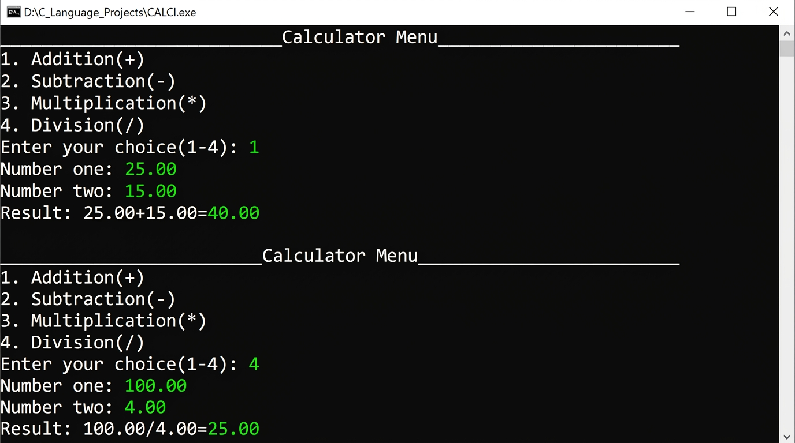

# Calculator Program

A menu-driven C calculator that performs the four basic arithmetic operations on two `double` values.

## Source Code

[View `CALCI.c`](../CALCI.c)

## Features

- Addition, subtraction, multiplication, and division.
- Accepts two `double` values for precision.
- Handles division by zero gracefully.

## Screenshot



[Open the screenshot](../screenshots/CALCI_output.jpg)

## Run

```bash
gcc CALCI.c -o calci
./calci
```

## Author

**saba1207B** · [GitHub profile](https://github.com/saba1207B)

---
Copyright © 2026 Sabareesh M (saba1207B). All Rights Reserved. See the repository [LICENSE](../LICENSE) and [COPYRIGHT](../COPYRIGHT) files.
