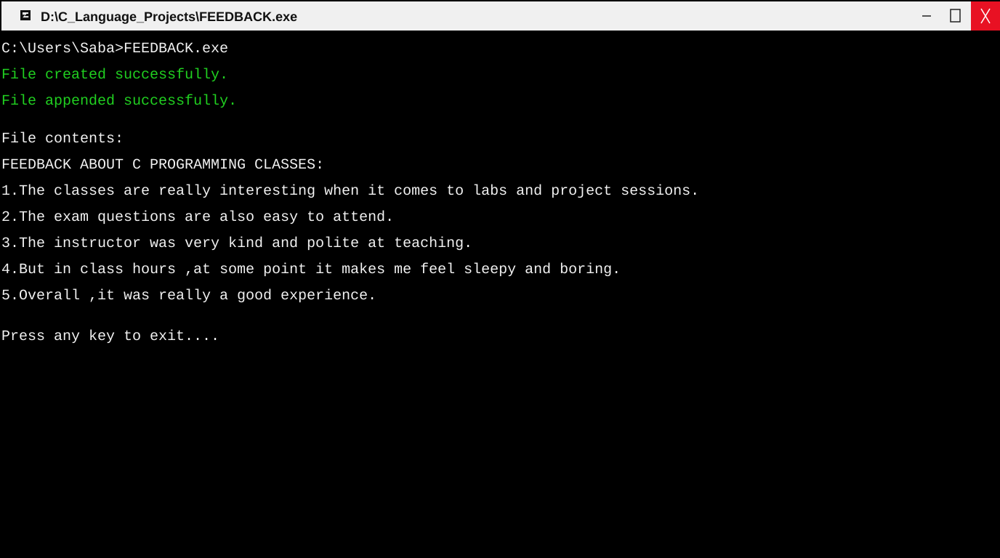

# 📝 Feedback File Program

A file-handling program written in C. It creates a text file, appends five feedback statements about C programming classes, and reads the saved contents back to the terminal.

## Source Code

[View `FEEDBACK.C`](../FEEDBACK.C)

## Features

- Creates `feedback.txt` and writes a heading.
- Appends five feedback statements to the file.
- Opens the file for reading.
- Displays the saved file contents in the terminal.
- Checks whether each file-open operation succeeds.

## Concepts Demonstrated

- File handling with `fopen()` and `fclose()`
- Writing with `fprintf()`
- Reading line by line with `fgets()`
- File modes: write (`w`), append (`a`), and read (`r`)
- Conditional checks and loops

## Screenshot

[Open the screenshot](../screenshots/FEEDBACK_output.svg)

## Compatibility Notes

The current source includes `conio.h` and calls `clrscr()` and `getch()`. It therefore targets a Turbo C/Borland-compatible environment unless those legacy console calls are removed or replaced for the compiler being used.

The program creates or writes `feedback.txt` in its current working directory.

## Author

**saba1207B** · [GitHub profile](https://github.com/saba1207B)

---

Copyright © 2026 Sabareesh M (saba1207B). All Rights Reserved. See the repository [LICENSE](../LICENSE) and [COPYRIGHT](../COPYRIGHT) files.
