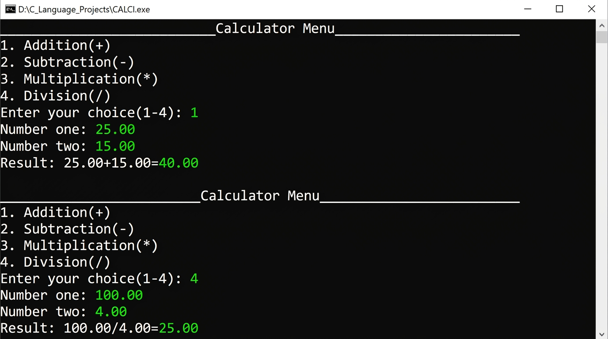
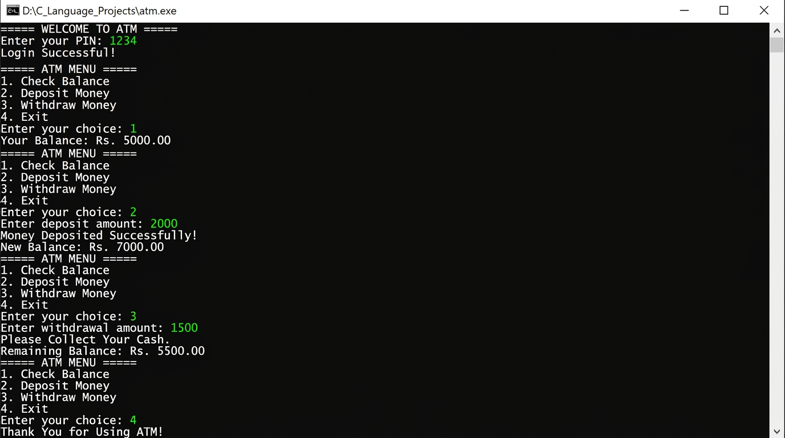
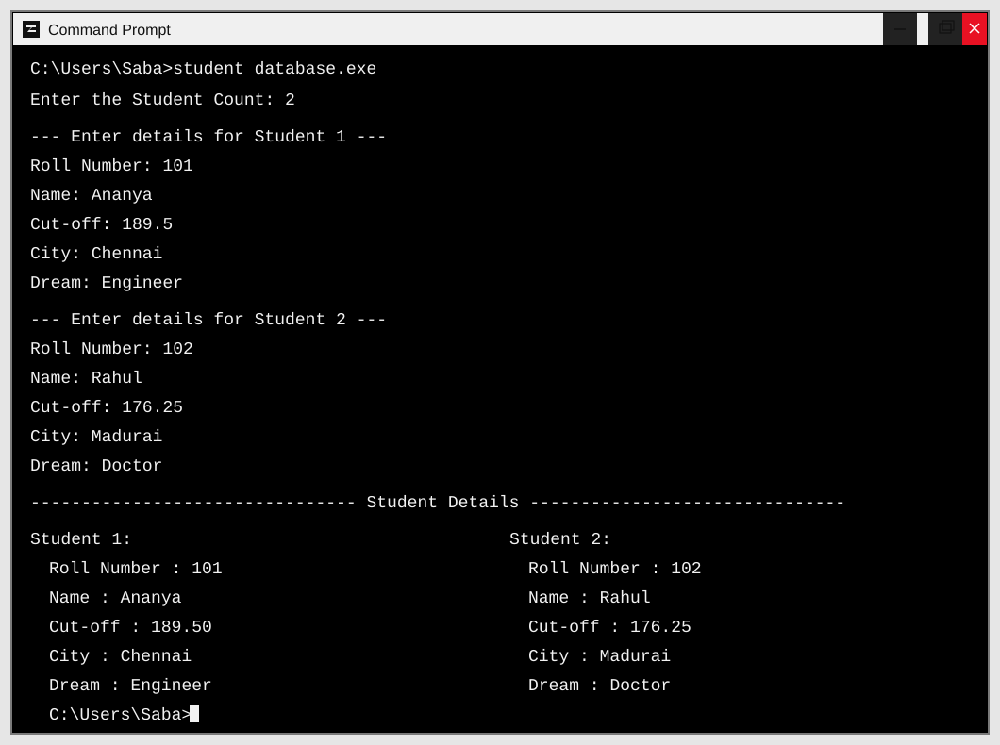

# 🖥️ C Language Assignments

A collection of console-based programs written in **C** as part of my C programming coursework.

---

## 📁 Projects

### 1. 🧮 CALCI.c — Calculator

A simple menu-driven calculator that performs basic arithmetic operations.

**Features:**
| Option | Operation |
|--------|-----------|
| 1 | Addition (+) |
| 2 | Subtraction (-) |
| 3 | Multiplication (*) |
| 4 | Division (/) |

**Highlights:**
- Accepts two `double` values for precision
- Handles division by zero gracefully
- Clean menu interface

#### 📸 Terminal Output Screenshot


---

### 2. 🏧 atm.c — ATM Application

A console-based ATM simulation with PIN authentication and account management.

**Features:**
| Option | Description |
|--------|-------------|
| PIN Login | Validates against stored PIN (default: `1234`) |
| 1. Check Balance | Displays current balance (starts at Rs. 5000.00) |
| 2. Deposit Money | Adds entered amount; rejects zero or negative values |
| 3. Withdraw Money | Deducts amount if balance is sufficient |
| 4. Exit | Ends the session with a farewell message |

**Highlights:**
- `do-while` loop keeps the menu active until user exits
- `switch` statement handles all menu choices
- Full input validation for deposits and withdrawals

#### 📸 Terminal Output Screenshot


---

### 3. 🎓 student_database.c — Student Database

A console program that collects and displays details for a group of students. Each record contains a roll number, name, cut-off score, city, and dream/goal.

**Features:**
| Field | Description |
|-------|-------------|
| Roll Number | Student's integer identifier |
| Name | Student's name |
| Cut-off | Student's cut-off score, displayed to two decimal places |
| City | Student's city |
| Dream | Student's stated dream or goal |

**Highlights:**
- Accepts a student count and gathers the five fields for each student
- Stores records in an array of `struct student` (maximum capacity: 100)
- Uses separate input and display functions
- Prints all entered records in a readable format

> **Note:** This program displays the records entered during the current run; it does not save them to a file. The source currently uses `conio.h` (`clrscr()` and `getch()`), so it requires a Turbo C/Borland-compatible environment unless those legacy console calls are replaced for your compiler.

#### 📸 Terminal Output Screenshot


---

## 🛠️ How to Compile & Run

Make sure you have **GCC** installed for the Calculator and ATM programs.

```bash
# Calculator
gcc CALCI.c -o calci
./calci

# ATM Application
gcc atm.c -o atm
./atm
```

`student_database.c` uses legacy `conio.h` functions and is not directly compatible with standard GCC. Run it in Turbo C/Borland C, or replace `clrscr()`/`getch()` and remove the `conio.h` include before compiling with GCC.

> **Windows users:** Use [MinGW](https://www.mingw-w64.org/) or [TDM-GCC](https://jmeubank.github.io/tdm-gcc/) for the programs compatible with GCC.

---

## 📚 Concepts Covered

- `printf` / `scanf` for I/O
- `if-else` conditional statements
- `switch-case` for menu handling
- `do-while` loop
- Data types: `int`, `float`, `double`
- Structures, arrays, and functions
- Input validation & error handling

---

## 👤 Author

**saba1207B**  
GitHub: [@saba1207B](https://github.com/saba1207B)

---

*Made with ❤️ as part of C Language coursework.*
