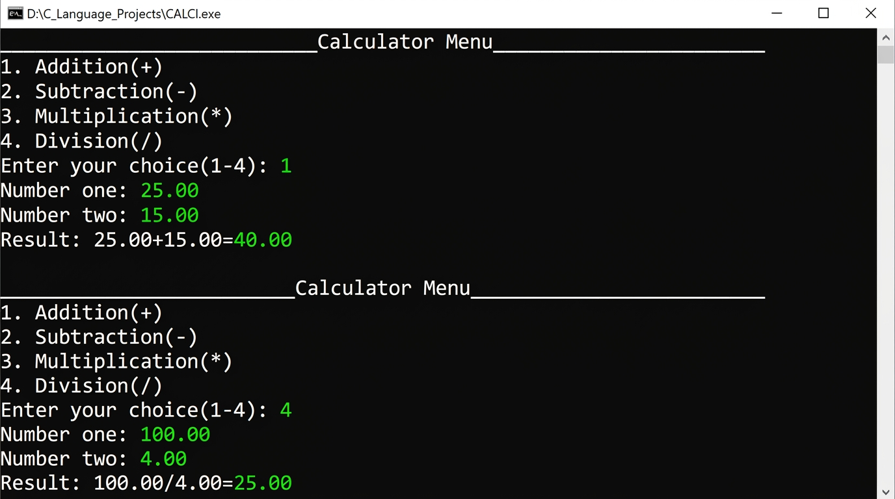
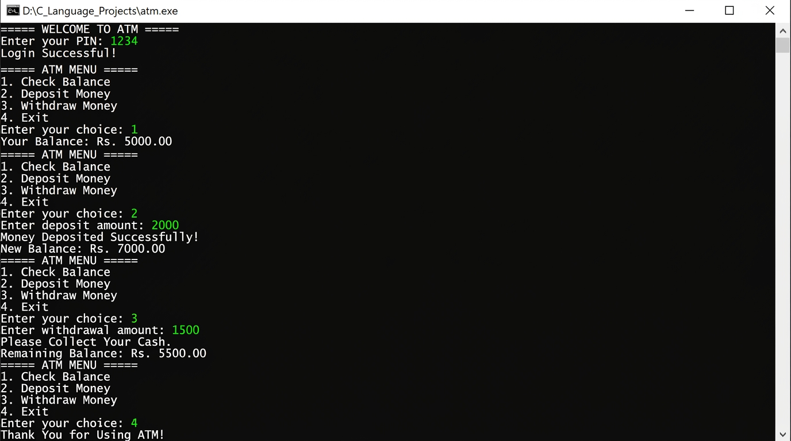

# 🖥️ C Language Assignments

A collection of console-based programs written in **C** as part of my C programming coursework.

---

## 📁 Projects

### 1. 🧮 CALCI.c — Calculator

A simple menu-driven calculator that performs basic arithmetic operations.

**Features:**
| Option | Operation |
|--------|-----------|
| 1 | Addition (+) |
| 2 | Subtraction (-) |
| 3 | Multiplication (*) |
| 4 | Division (/) |

**Highlights:**
- Accepts two `double` values for precision
- Handles division by zero gracefully
- Clean menu interface

#### 📸 Terminal Output Screenshot


---

### 2. 🏧 atm.c — ATM Application

A console-based ATM simulation with PIN authentication and account management.

**Features:**
| Option | Description |
|--------|-------------|
| PIN Login | Validates against stored PIN (default: `1234`) |
| 1. Check Balance | Displays current balance (starts at Rs. 5000.00) |
| 2. Deposit Money | Adds entered amount; rejects zero or negative values |
| 3. Withdraw Money | Deducts amount if balance is sufficient |
| 4. Exit | Ends the session with a farewell message |

**Highlights:**
- `do-while` loop keeps the menu active until user exits
- `switch` statement handles all menu choices
- Full input validation for deposits and withdrawals

#### 📸 Terminal Output Screenshot


---

## 🛠️ How to Compile & Run

Make sure you have **GCC** installed.

```bash
# Calculator
gcc CALCI.c -o calci
./calci

# ATM Application
gcc atm.c -o atm
./atm
```

> **Windows users:** Use [MinGW](https://www.mingw-w64.org/) or [TDM-GCC](https://jmeubank.github.io/tdm-gcc/) and run via Command Prompt or PowerShell.

---

## 📚 Concepts Covered

- `printf` / `scanf` for I/O
- `if-else` conditional statements
- `switch-case` for menu handling
- `do-while` loop
- Data types: `int`, `float`, `double`
- Input validation & error handling

---

## 👤 Author

**saba1207B**  
GitHub: [@saba1207B](https://github.com/saba1207B)

---

*Made with ❤️ as part of C Language coursework.*