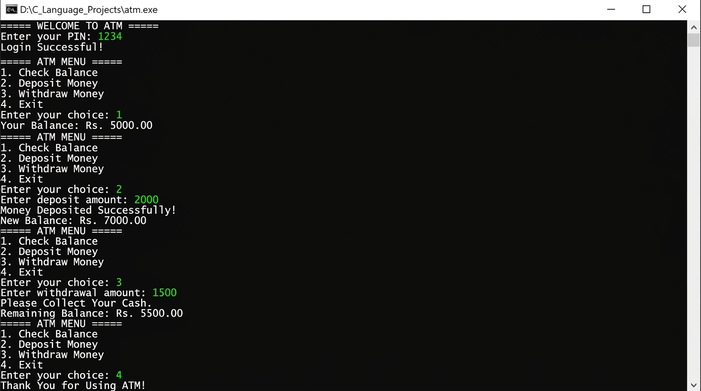

# ATM Application

A console-based ATM simulation in C with PIN authentication and basic account management.

## Source Code

[View `atm.c`](../atm.c)

## Features

- Authenticates using the sample PIN `1234`.
- Checks the current balance.
- Deposits money and rejects zero or negative amounts.
- Withdraws money when the balance is sufficient.
- Repeats the menu until the user exits.

## Screenshot



[Open the screenshot](../screenshots/ATM_output.jpg)

## Run

```bash
gcc atm.c -o atm
./atm
```

## Author

**saba1207B** · [GitHub profile](https://github.com/saba1207B)

---
Copyright © 2026 Sabareesh M (saba1207B). All Rights Reserved. See the repository [LICENSE](../LICENSE) and [COPYRIGHT](../COPYRIGHT) files.
