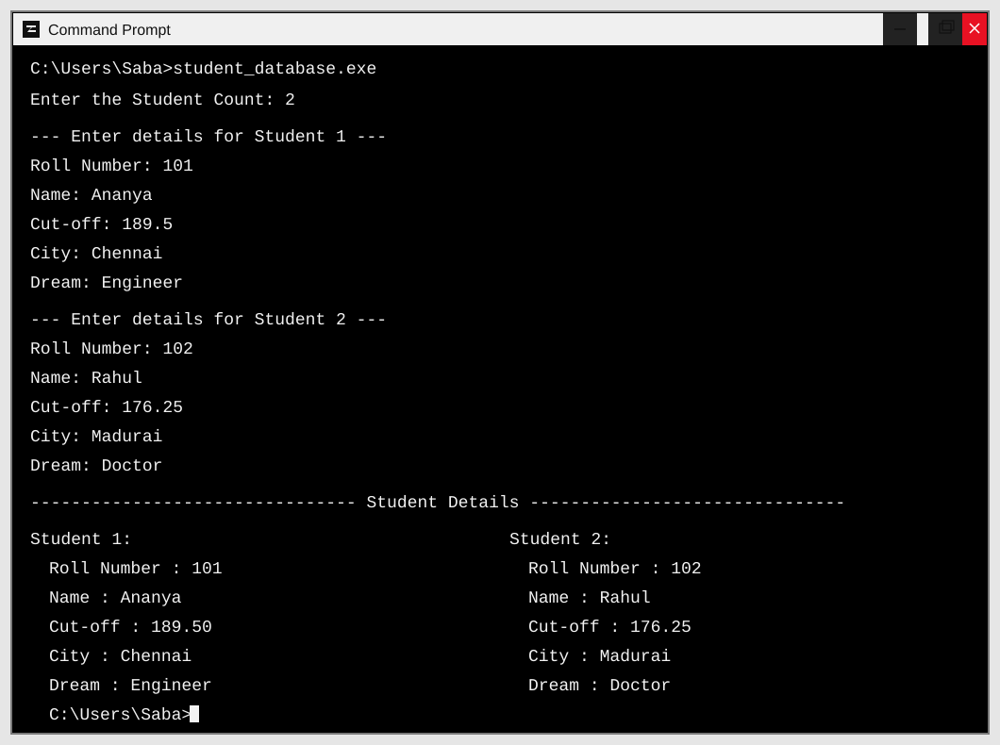

# 🎓 Student Database Program

A console-based C program that collects and displays records for multiple students.

## Source Code

[View `student_database.c`](../student_database.c)

## Features

- Accepts the number of students to enter.
- Collects each student's roll number, name, cut-off score, city, and dream/goal.
- Stores records in an array of `struct student` (declared capacity: 100).
- Uses separate functions for input and output.
- Displays all entered student records in a readable format.

## Concepts Demonstrated

- Structures (`struct`)
- Arrays of structures
- Functions and function parameters
- Loops
- Standard input/output with `scanf` and `printf`

## Screenshot

[Open the screenshot](../screenshots/student_database_output.svg)

## Compatibility Notes

The current source includes `conio.h` and calls `clrscr()` and `getch()`. It therefore targets a Turbo C/Borland-compatible environment unless those legacy console calls are removed or replaced for the compiler being used.

The program currently displays records entered during that run; it does not save them to a file. The array is declared for 100 records, but the current source does not validate that the entered student count is within that limit.

## Author

**saba1207B** · [GitHub profile](https://github.com/saba1207B)

---

Copyright © 2026 Sabareesh M (saba1207B). All Rights Reserved. See the repository [LICENSE](../LICENSE) and [COPYRIGHT](../COPYRIGHT) files.
